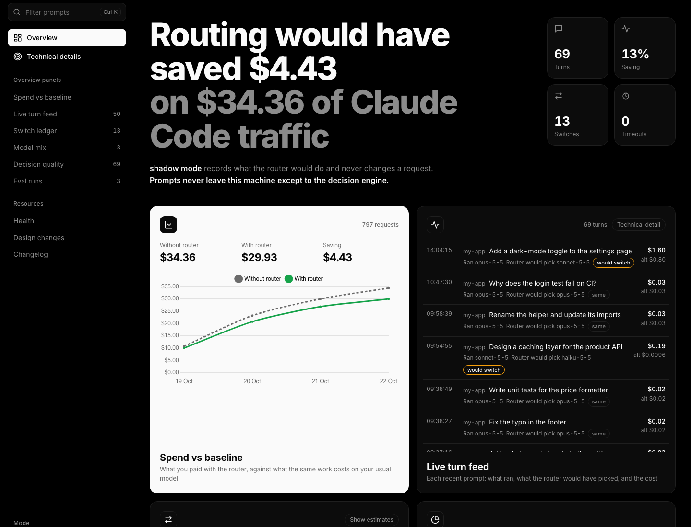

# smartrouter

**Pick the right Claude model for every prompt, automatically, and see what it saves.**

smartrouter sits between Claude Code and Anthropic on your own machine. For each prompt it decides whether it needs Opus (the senior expert), Sonnet (the regular staff) or Haiku (the junior), and it logs every decision, token and dollar to a local dashboard.



## What it does, in plain words

Think of a receptionist at an office:

1. You (Claude Code) hand over a request.
2. The receptionist reads it and asks a quick advisor, "how hard is this?"
3. Before handing work to someone new, the receptionist weighs the cost of switching. A new person has to re-read the whole file first, which costs money (this is the "prompt cache").
4. The request goes to the chosen person (Anthropic), and the answer comes back to you.
5. Everything is written in a logbook you can read: the dashboard.

```
Claude Code  ->  smartrouter (127.0.0.1:8787)  ->  Anthropic (Opus, Sonnet or Haiku)
                       |
                       +-> dashboard: cost, decisions, switches
```

It has three modes:

| Mode | What happens |
| --- | --- |
| `off` | Passes everything through. Logs cost only. |
| `shadow` (default) | Watches and records which model it *would* pick. Never changes anything. |
| `active` | Really switches the model for your prompts. |

Everything runs on `127.0.0.1` only. Your prompts go to Anthropic as usual, plus a short summary to the decision engine (ScaleDown by default).

**Status:** proof of concept. All core milestones (M0–M6) are built. It runs in shadow mode until the go/no-go review passes. The dashboard's **Changelog** page explains what was built and why.

## Quick start

You need:

- macOS
- [Claude Code](https://docs.claude.com/en/docs/claude-code)
- [uv](https://docs.astral.sh/uv/) (it installs Python 3.11 for you)
- a ScaleDown API key

1. **Get the code and install it.**

   ```bash
   git clone https://github.com/priteshranoliya-creator/smartrouter.git
   cd smartrouter
   uv sync
   cp .env.example .env      # then put your SCALEDOWN_API_KEY in .env
   ```

2. **Start the router in the background.** It starts at every login and restarts if it stops.

   ```bash
   uv run router service install
   uv run router service status   # should say: agent loaded, healthz status ok, mode shadow
   ```

3. **Turn it on for a project.** It only sees projects you opt in.

   ```bash
   uv run router install --project ~/path/to/your-project
   ```

4. **Use Claude Code as usual, from that folder.**

   ```bash
   cd ~/path/to/your-project
   claude
   ```

5. **Open the dashboard** at http://127.0.0.1:8787. Your prompts appear in the *Live turn feed*.

To stop using it in a project, run `uv run router uninstall --project ~/path/to/your-project`. To stop the background router, run `uv run router service uninstall`.

## Switching from shadow to active mode

Active mode changes which model answers your prompts, so it is locked by default. Do this only after the go/no-go review says **GO**.

1. **Run the review** after at least 7 days and 50 prompts in shadow mode:

   ```bash
   uv run router review
   ```

   It checks that routing is cheaper, keeps quality, pays back its switches, stays fast and logs everything. Read the verdict at the top.

2. **Sign the decision.** Tick the box and add the date in `docs/decisions/t6.1-go-no-go.md`.

3. **Unlock and turn on active mode.** In `config/router.yaml`, set these two lines:

   ```yaml
   mode: active
   allow_active: true
   ```

   If your `.env` has a `ROUTER_MODE` line, that line wins over the config file. Set it to `active` too, or remove it.

4. **Restart the router** so it reads the change:

   ```bash
   uv run router service uninstall && uv run router service install
   uv run router service status   # should now say mode active
   ```

5. **Start a new Claude Code session** and check the dashboard. Feed rows now read "switched" when the router moved a prompt to another model.

**To go back:** click **shadow** (or **off**) in the dashboard's Mode switch. That works right away, until the next restart. To make it permanent, set `mode: shadow` in `config/router.yaml` and restart the router. The dashboard's **active** button stays greyed out on purpose, because active mode is only turned on through the config file.

If a model ever refuses a rewritten request, the router retries once on the model Claude Code asked for. The rest of that prompt then stays on that model.

## Everyday commands

| Command | What it does |
| --- | --- |
| `uv run router service status` | Is the router running, and in which mode? |
| `uv run router service install` / `uninstall` | Start or stop the background router |
| `uv run router install --project PATH` | Route a project's Claude Code sessions through the router |
| `uv run router uninstall --project PATH` | Undo that, restoring the original settings file |
| `uv run router review` | Go/no-go check on the shadow data |
| `uv run router export --since 7d` | One CSV row per request |
| `uv run router serve` | Run in the foreground instead of as a service |

## Troubleshooting

- **Prompts don't show up on the dashboard.**
  - Start `claude` from the folder you installed, not a parent folder or a subfolder.
  - Start a new Claude Code session after `router install`; Claude only reads settings at startup.
- **`service status` shows healthz failing.**
  - Look in `data/logs/`.
  - A missing or wrong key in `.env` is the usual cause.
- **The router can't read files.**
  - Background (launchd) services on macOS can't open `~/Desktop`, `~/Documents` or `~/Downloads`.
  - Keep this repo elsewhere, for example `~/Developer`. The projects you route can live anywhere.

## Contributing

### Development setup

```bash
uv sync
cp .env.example .env
make check          # ruff, mypy --strict and the test suite; must pass before every commit
uv run uvicorn smartrouter.app:create_app --factory --host 127.0.0.1 --port 8787
```

If the background service is already using port 8787, run your development copy on another port (`--port 8790`) and point a test project at it.

### How we work

- **Tests first.** Write the failing test, then the code.
- **One commit per ticket**, made only after `make check` passes. Ticket ids (T1.1 … T6.3) come from the technical design document.
- **Record design changes.** Any departure from the design gets a row in [`docs/tdd-changes.md`](docs/tdd-changes.md).
- **Check before you push.** Never commit `data/`, `.env`, API keys or personal paths.
- **Never turn on active mode** in a shared config without the owner's sign-off.

### Project layout

| Path | What lives there |
| --- | --- |
| `src/smartrouter/api/` | Proxy, hook endpoints, dashboard APIs, live event stream |
| `src/smartrouter/decision/` | Decision engines (ScaleDown, Laya) and the per-turn decision service |
| `src/smartrouter/policy/` | Routing rules and the cache-aware cost estimator |
| `src/smartrouter/telemetry/` | SQLite database, recorder, prices, stats, CSV export |
| `src/smartrouter/eval/` | Golden-set eval runner, judge and reports |
| `hooks/` | Small scripts Claude Code runs on each prompt and before compaction |
| `config/` | `router.yaml`, `questions.yaml`, `pricing.yaml` |
| `migrations/` | Numbered SQL migrations, applied on startup |
| `dashboard/` | Preact + TypeScript + Vite dashboard; the built `dist/` is committed |
| `docs/` | Design changes, decisions, spike notes |

### Dashboard

You only need Node 22+ to change the dashboard.

```bash
make dashboard        # rebuild dashboard/dist
make dashboard-check  # type-check, and confirm the committed build is current
make ui-check         # clicks every control in headless Chrome against the running router
```

## Evaluate

The golden set lives in `data/golden/golden.jsonl`:

- One JSON object per line: prompt, context, reference answer, 2–5 rubric points, expected tier, and train/test split.
- It is git-ignored because it is built from real prompts. Bring your own file in that format; see `tests/fixtures/golden_small.jsonl` for an example.

```bash
uv run router eval validate                    # schema, tiers and split counts
uv run router eval smoke --item g-0007         # one item through every arm
uv run router eval calibrate                   # fit the engine's temperature on train, report on test
uv run router eval run --split test            # every arm + router + oracle, judged by Gemini Argon
uv run router eval report                      # latest run: arm table, routing matrix, judge agreement
```

Claude arms run through `claude -p` with your Claude Code login. Gemini arms and the judge need `GEMINI_API_KEY` (or `GOOGLE_API_KEY`) in `.env`. Reports are written to `data/reports/`, and the dashboard's Eval panel shows the same numbers.

## More

- Design changes from the original technical design: [`docs/tdd-changes.md`](docs/tdd-changes.md)
- Go/no-go decision: [`docs/decisions/t6.1-go-no-go.md`](docs/decisions/t6.1-go-no-go.md)
- Spike findings: [`docs/spikes/`](docs/spikes/)
